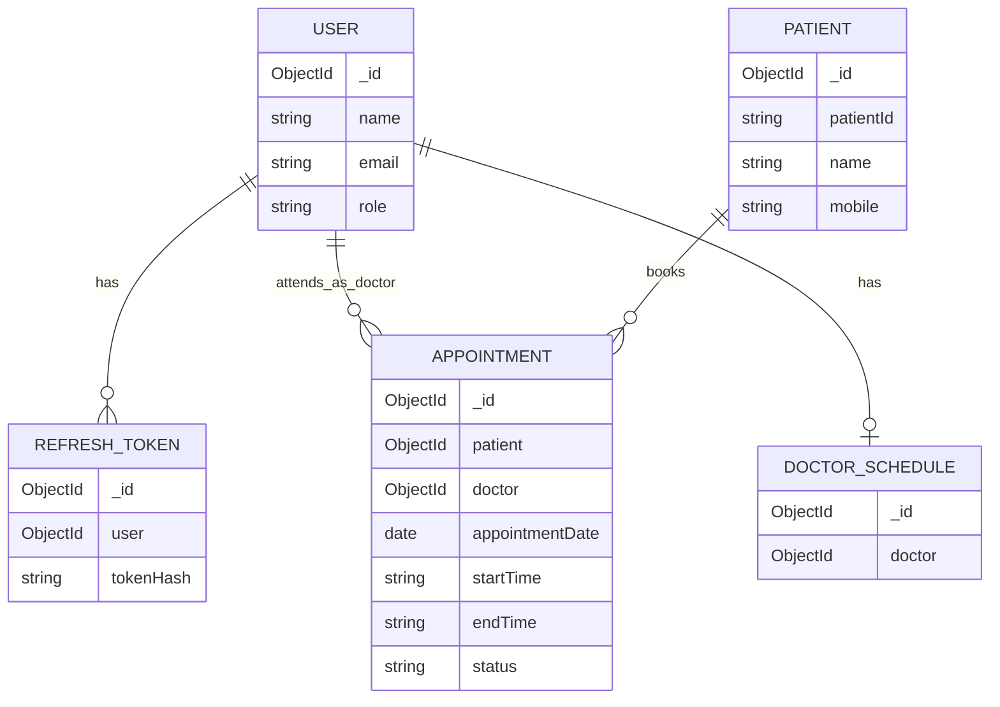

# EMR Appointment Management System — Database Schema

## 1. Overview

The application uses MongoDB with Mongoose for database access. The database stores user accounts, refresh tokens, patient records, doctor schedules, and appointments.

The following schema documents the main collections and their relationships. Confirm the exact field names, types, required fields, and indexes against the Mongoose models before submission.

## 2. Collections

### 2.1 User

**Model:** `User.js`

Stores staff accounts and their roles.

| Field        | Purpose                                    |
| ------------ | ------------------------------------------ |
| `_id`        | MongoDB document identifier                |
| `name`       | User's name                                |
| `email`      | Login email                                |
| `password`   | Bcrypt-hashed password                     |
| `role`       | `super_admin`, `doctor`, or `receptionist` |
| `department` | Doctor's department, where applicable      |
| Timestamps   | Creation and update times, if enabled      |

**Purpose:** Supports authentication, role-based access control, and staff management.

Passwords must never be stored in plain text.

### 2.2 RefreshToken

**Model:** `RefreshToken.js`

Stores refresh-token information for session management.

| Field          | Purpose                               |
| -------------- | ------------------------------------- |
| `_id`          | MongoDB document identifier           |
| Token hash     | Hash of the refresh token             |
| User reference | Associated user                       |
| Expiry         | Token expiration time                 |
| Timestamps     | Creation and update times, if enabled |

**Purpose:** Supports refresh-token validation, rotation, expiration, and logout invalidation.

The raw refresh token should not be stored in the database.

### 2.3 Patient

**Model:** `Patient.js`

Stores patient demographic and contact information.

| Field         | Purpose                               |
| ------------- | ------------------------------------- |
| `_id`         | MongoDB document identifier           |
| `patientId`   | Generated patient identifier          |
| `name`        | Patient's name                        |
| `mobile`      | Contact number                        |
| `dateOfBirth` | Date of birth                         |
| `gender`      | Gender                                |
| Timestamps    | Creation and update times, if enabled |

**Purpose:** Allows authorized staff to register and search patients and associate patients with appointments.

The generated patient identifier should follow the format implemented in the project.

### 2.4 DoctorSchedule

**Model:** `DoctorSchedule.js`

Stores a doctor's working schedule.

| Field            | Purpose                                  |
| ---------------- | ---------------------------------------- |
| `_id`            | MongoDB document identifier              |
| Doctor reference | Doctor associated with the schedule      |
| `workingDays`    | Days on which the doctor works           |
| Sessions         | Working time periods                     |
| Breaks           | Break periods, if represented separately |
| Timestamps       | Creation and update times, if enabled    |

**Purpose:** Defines the working periods used to calculate available appointment slots.

The exact nested structure for sessions and breaks should match the current `DoctorSchedule.js` model.

### 2.5 Appointment

**Model:** `Appointment.js`

Stores appointment bookings and their lifecycle.

| Field               | Purpose                               |
| ------------------- | ------------------------------------- |
| `_id`               | MongoDB document identifier           |
| Patient reference   | Associated patient                    |
| Doctor reference    | Assigned doctor                       |
| `appointmentDate`   | Appointment date                      |
| `startTime`         | Appointment start time                |
| `endTime`           | Appointment end time                  |
| `status`            | Appointment status                    |
| `consultationNotes` | Doctor's notes, where supported       |
| Timestamps          | Creation and update times, if enabled |

**Purpose:** Supports booking, searching, updating, cancellation, patient arrival, and consultation completion.

Expected statuses in the application include:

- `scheduled`
- `arrived`
- `completed`
- `cancelled`

Use the exact enum values defined in `Appointment.js`.

## 3. Relationships

The main relationships are:

- One user account with the doctor role can have many appointments.
- One patient can have many appointments.
- A doctor can have a schedule defining working days, sessions, and breaks.
- A user can have multiple refresh-token records over time, depending on the session implementation.

MongoDB references connect related documents where the models use Mongoose `ObjectId` references.

## 4. Relationship diagram

**Note:** This diagram is conceptual. Confirm that the reference field names and relationship cardinalities match the actual models.

## 5. Validation and integrity

The application should validate:

- Required patient and staff fields.
- Valid user roles and appointment statuses.
- Valid appointment dates and time ranges.
- Doctor working days, sessions, and breaks.
- Appointment overlap and slot availability.
- Valid references to existing patients and doctors.

Application-level validation and database-level constraints are different. Document a database uniqueness or concurrency guarantee only if the corresponding index or other database mechanism is implemented and tested.

## 6. Security and privacy

- Passwords are stored as bcrypt hashes.
- Refresh tokens are stored as hashes.
- Patient information is available only to authorized roles.
- Environment secrets are stored outside source control.
- API authorization should be enforced by the backend, not only by frontend route protection.

## 7. Schema maintenance

Whenever a model changes, update this document and the relationship diagram. The Mongoose model definitions are the source of truth for the implemented database schema.
